<p align="center">
  
</p>

<h1 align="center">Mermaid Word AddIn</h1>

<p align="center">
  <a href="LICENSE"></a>
  <a href="https://mermaid-word-addin.pages.dev/"></a>
  <a href="https://mermaid-word-addin.pages.dev/manifest.xml"></a>
</p>

**English** | [简体中文](README.zh-CN.md)

> A Mermaid diagramming tool built for Microsoft Word: live preview and one-click insertion of high-resolution PNG or vector SVG images.
>
> Both formats save the Mermaid source with each diagram, so you can select an image to edit it again or switch formats.

## Contents

- [Contents](#contents)
- [Features](#features)
- [Quick Start](#quick-start)
  - [Word on the web](#word-on-the-web)
  - [Word for Windows (desktop)](#word-for-windows-desktop)
- [Developer Guide](#developer-guide)
  - [Environment](#environment)
  - [Install and start](#install-and-start)
  - [Build and debug](#build-and-debug)
- [Deployment](#deployment)
- [Troubleshooting and Feedback](#troubleshooting-and-feedback)
- [References](#references)
- [License](#license)

## Features

- **Multiple diagram types**: Flowcharts, sequence diagrams, class diagrams, state diagrams, ER diagrams, Gantt charts, pie charts, mindmaps, and more.

  <table>
    <tr>
      <td align="center" valign="middle" width="50%" height="255">
        <a href="docs/images/diagram-flowchart.png">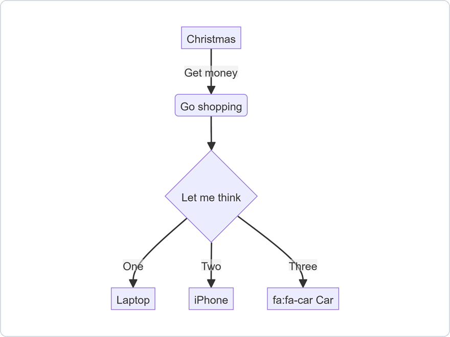</a>
        <br>
        <sub>Flowchart</sub>
      </td>
      <td align="center" valign="middle" width="50%" height="255">
        <a href="docs/images/diagram-sequence.png">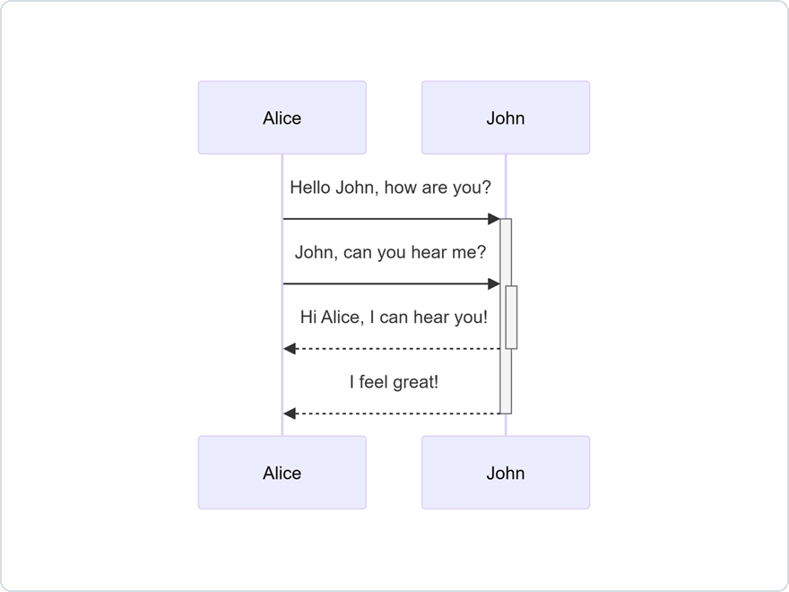</a>
        <br>
        <sub>Sequence diagram</sub>
      </td>
    </tr>
    <tr>
      <td align="center" valign="middle" width="50%" height="255">
        <a href="docs/images/diagram-class.png">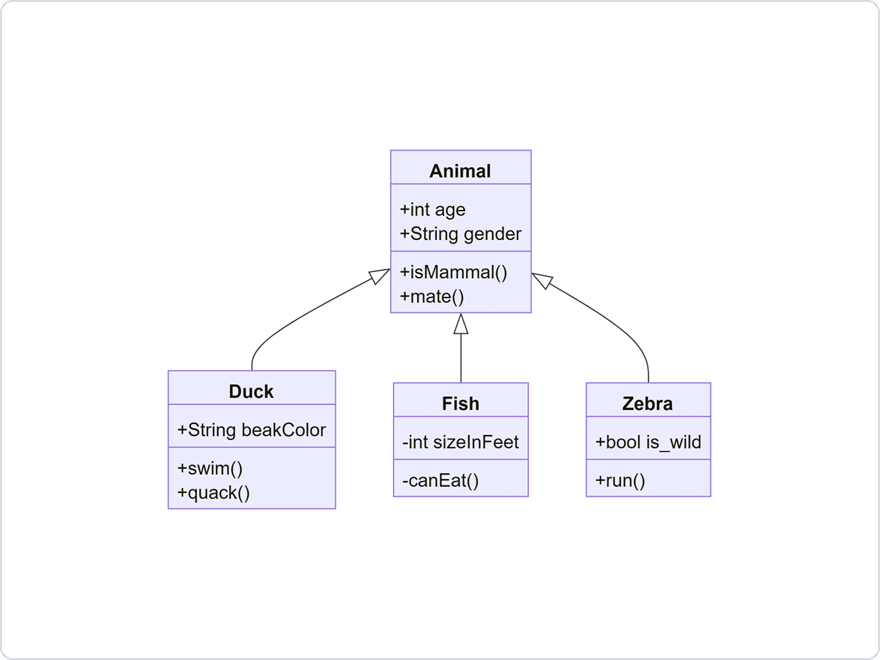</a>
        <br>
        <sub>Class diagram</sub>
      </td>
      <td align="center" valign="middle" width="50%" height="255">
        <a href="docs/images/diagram-state.png">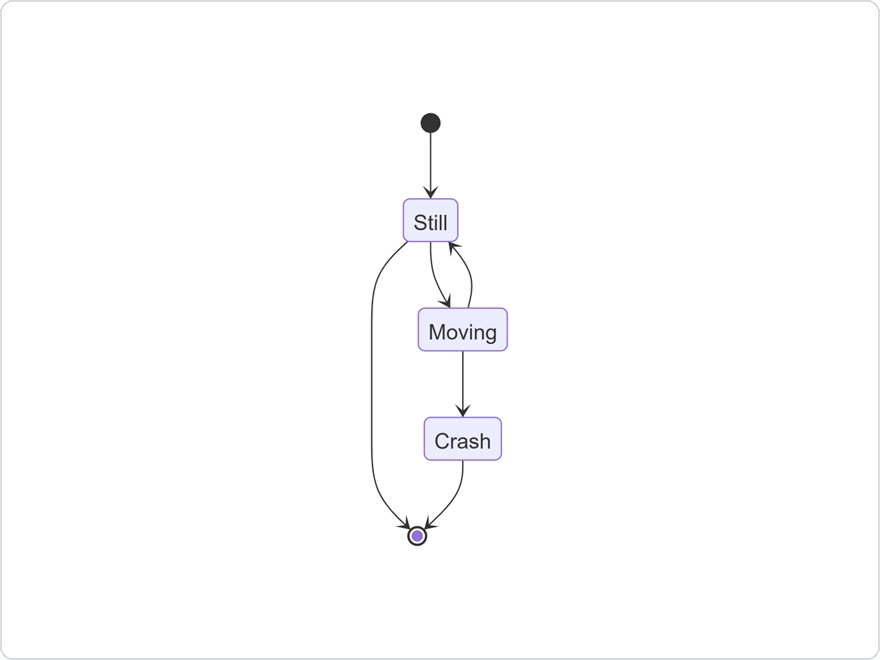</a>
        <br>
        <sub>State diagram</sub>
      </td>
    </tr>
    <tr>
      <td align="center" valign="middle" width="50%" height="255">
        <a href="docs/images/diagram-er.png">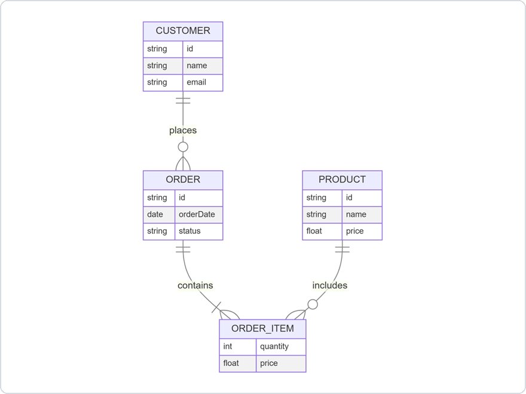</a>
        <br>
        <sub>ER diagram</sub>
      </td>
      <td align="center" valign="middle" width="50%" height="255">
        <a href="docs/images/diagram-gantt.png">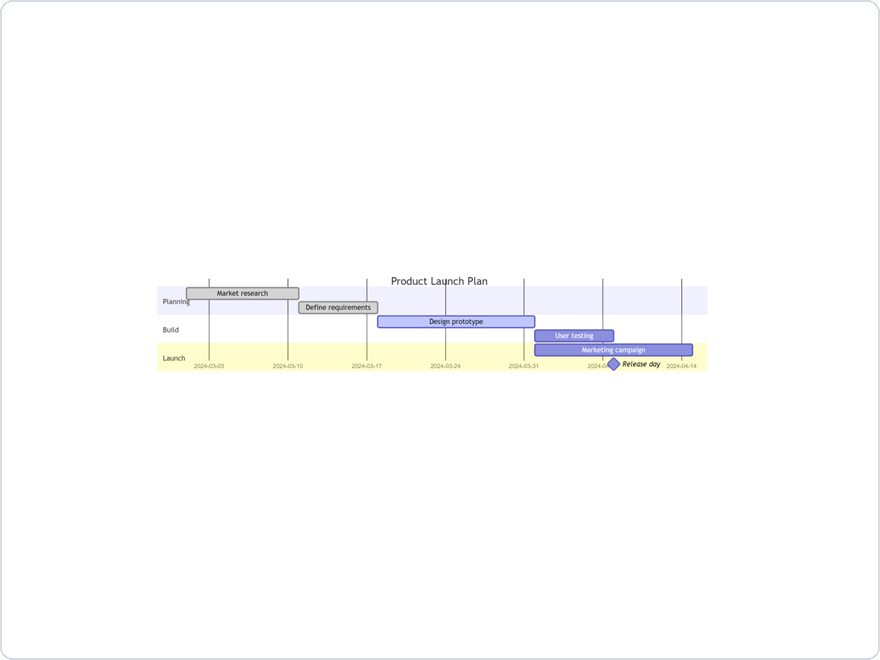</a>
        <br>
        <sub>Gantt chart</sub>
      </td>
    </tr>
    <tr>
      <td align="center" valign="middle" width="50%" height="255">
        <a href="docs/images/diagram-pie.png">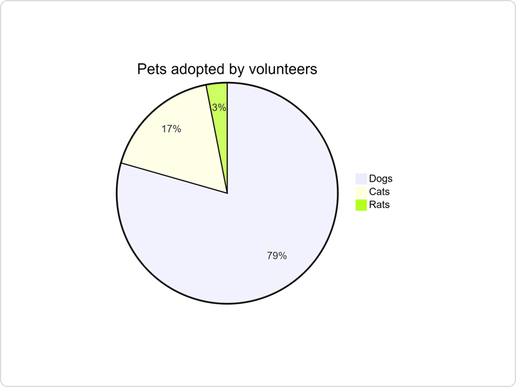</a>
        <br>
        <sub>Pie chart</sub>
      </td>
      <td align="center" valign="middle" width="50%" height="255">
        <a href="docs/images/diagram-mindmap.png">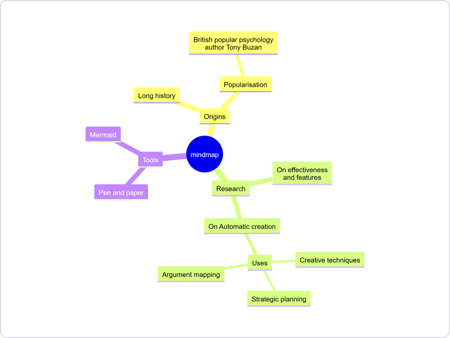</a>
        <br>
        <sub>Mindmap</sub>
      </td>
    </tr>
  </table>

  The syntax supported by this project follows Mermaid 12.3.x. The official ZenUML extension is bundled and registered automatically. See the [Mermaid documentation](https://mermaid.js.org/) for more examples and version-specific limitations.

- **Built-in examples**: **Example** provides 35 diagram examples from the same sources as [Mermaid Live Editor](https://mermaid-live.nodejs.cn/edit): one default per diagram type from `@mermaid-js/examples`, plus ZenUML's **Order Service**. Common types appear first and the rest are sorted by name in a scrollable menu. Examples are bundled locally and selecting one replaces the current editor text.

- **Rich editing experience**: Mermaid syntax highlighting, keyword completion, code folding, inline syntax diagnostics, and line wrapping. Flowcharts, sequence diagrams, mindmaps, pie charts, journeys, requirement diagrams, and Gantt charts are fully highlighted by the upstream grammar; the remaining diagram types use a lighter lexical highlighter that follows the detected diagram type.
- **Live preview**: See the rendered diagram while you edit. Zoom with the mouse wheel or the zoom buttons, reset the view, and drag to pan around larger diagrams.
- **Theme selection**: Switch between the default, forest, dark, and neutral Mermaid themes.
- **High-quality output**: Insert high-resolution PNG or vector SVG images. Choose the format from the dropdown on the right of **Insert | Replace**.
- **Shared re-editing**: Both PNG and SVG support re-editing. Select a picture, click **Edit Selected**, update the source, and replace it in either format.

## Quick Start

Download [`manifest.xml`](https://mermaid-word-addin.pages.dev/manifest.xml) before installing.

### Word on the web

1. Open an editable document in [Word on the web](https://word.cloud.microsoft), then go to **Home → Add-ins → More Add-ins**. Depending on your version, the entry point may be labeled **More Settings**.

   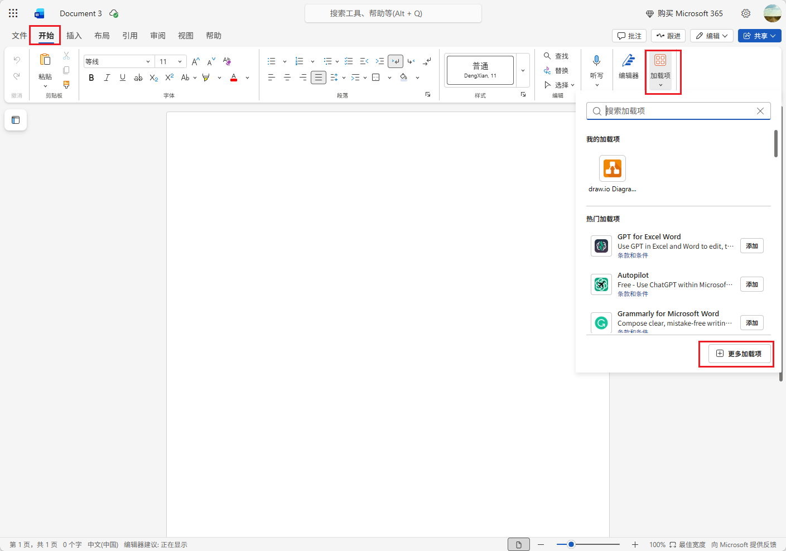

2. Switch to **My Add-ins**, expand **Manage My Add-ins**, click **Upload My Add-in**, and select the downloaded `manifest.xml`.

   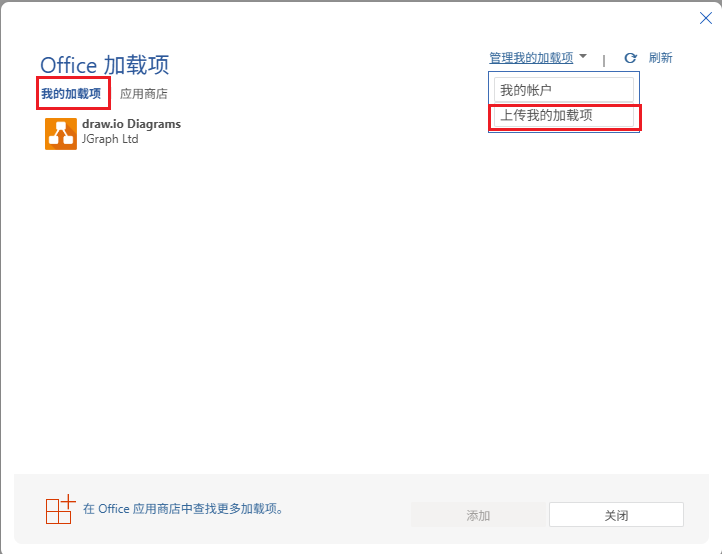

3. On the **Insert** tab, click **Mermaid Editor**. The editor and preview pane open on the right.

   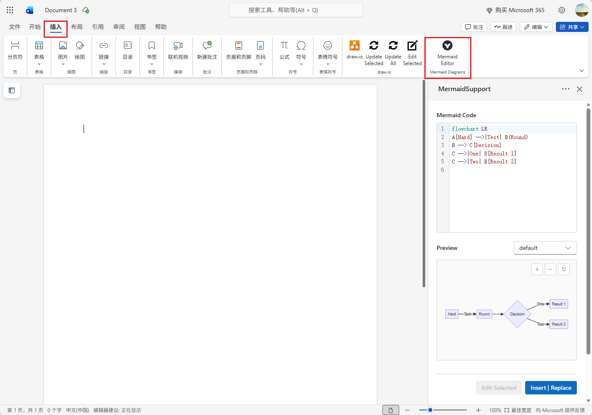

### Word for Windows (desktop)

1. **Create a shared folder.** Create a folder for the add-in manifest and put the downloaded `manifest.xml` in it. Right-click the folder, open **Properties → Sharing → Share...**, grant access to the Windows account that will use the add-in, and finish sharing. Copy the resulting network path.

   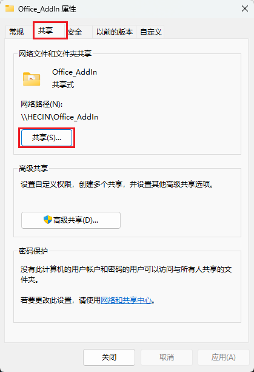

2. **Add a trusted add-in catalog.** In Word, go to **File → Options → Trust Center → Trust Center Settings → Trusted Add-in Catalogs**. Paste the network path from the previous step into **Catalog Url**, click **Add catalog**, select **Show in Menu** for the new entry, and close the settings windows with **OK**.

   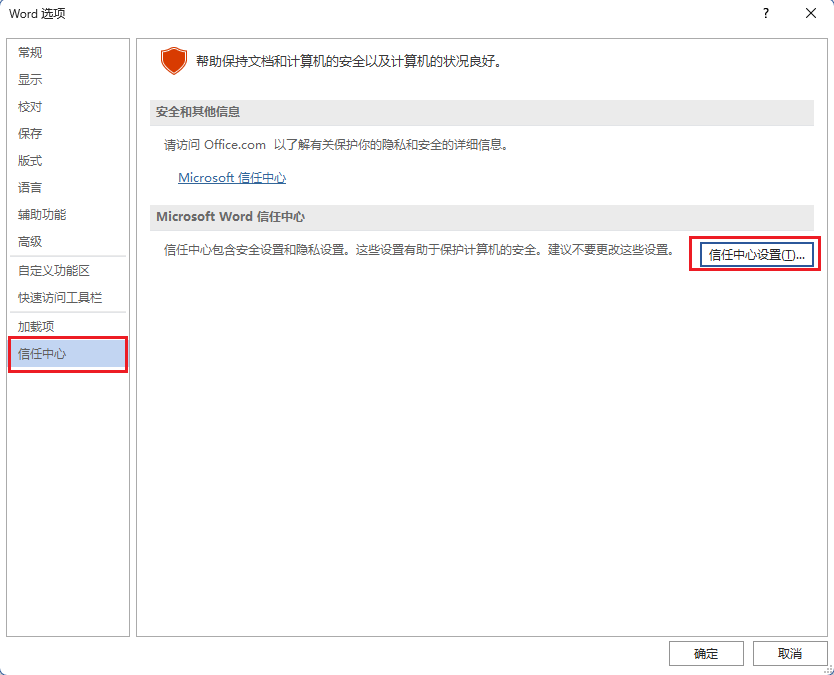

   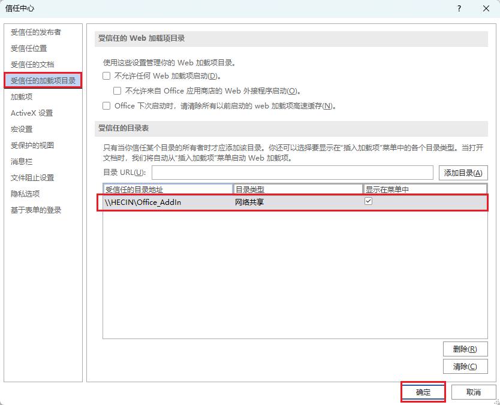

3. **Restart Word and install the add-in.** Reopen Word, go to **Developer → Add-ins**, select **Shared Folder** in the Office Add-ins dialog, choose this add-in, and click **Add**.

   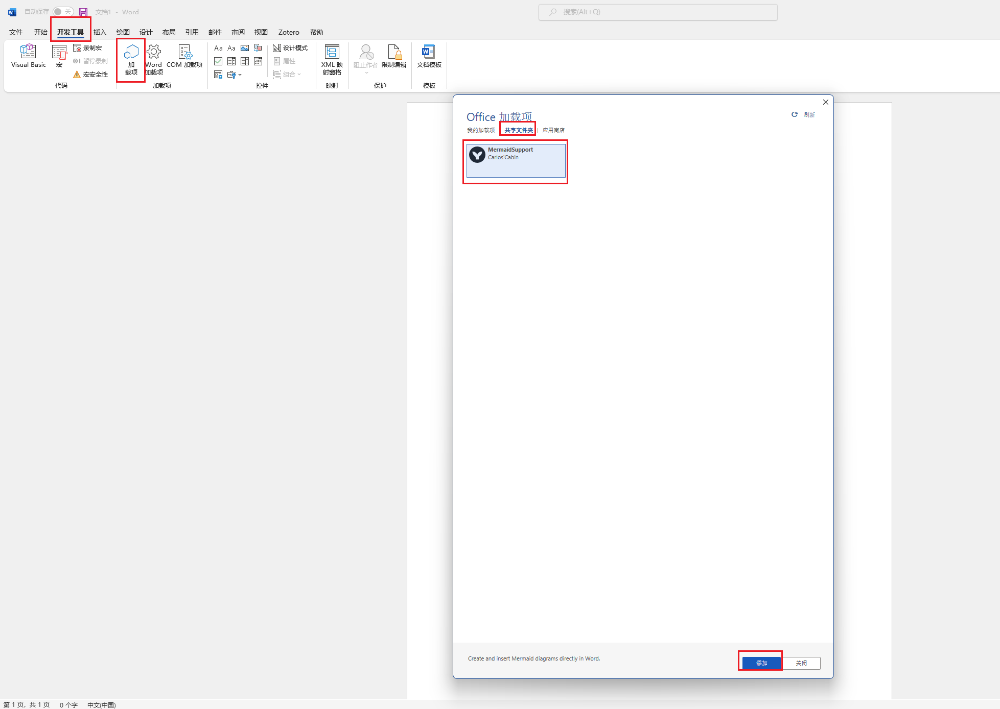

   Then open **Mermaid Editor** from the **Insert** tab.

   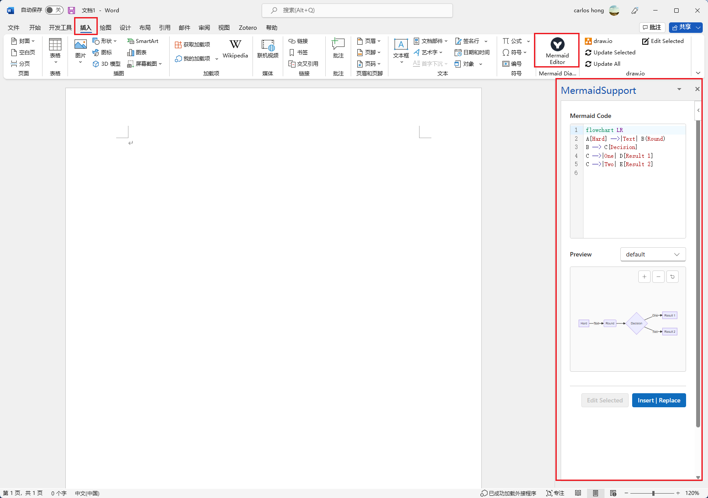

## Developer Guide

### Environment

- Node.js 22.12+ and npm (required by Mermaid 12 and the ZenUML extension)
- Git
- Word

### Install and start

Clone the repository and change into the project directory:

```bash
git clone https://github.com/siyuhong/Mermaid-Word-AddIn.git
cd Mermaid-Word-AddIn
```

Install dependencies:

```bash
npm install
```

### Build and debug

Build a development version:

```bash
npm run build:dev
```

On first setup, install the local HTTPS development certificate and trust it when the system prompts:

```bash
npx office-addin-dev-certs install
```

Start the development server:

```bash
npm run dev-server
```

In another terminal, sideload the add-in into Word:

```bash
npm start
```

When you are done debugging, remove the development add-in:

```bash
npm stop
```

## Deployment

- [Cloudflare Pages deployment](docs/cloudflare-pages.md)

## Troubleshooting and Feedback

- **Deployed add-in**: see [Verify the deployment](docs/cloudflare-pages.md#5-verify-the-deployment).
- **Local development build**: if the task pane fails to load, run `npx office-addin-dev-certs verify` to check the local HTTPS certificate. If it asks you to install the certificate, run `npx office-addin-dev-certs install` and trust it.

If the problem persists, [open an issue](https://github.com/siyuhong/Mermaid-Word-AddIn/issues).

## References

- [Mermaid documentation](https://mermaid.js.org/)
- [Office Add-ins documentation](https://learn.microsoft.com/office/dev/add-ins/overview/office-add-ins)
- [Word JavaScript API reference](https://learn.microsoft.com/javascript/api/word)
- [Sideload Office Add-ins for testing](https://learn.microsoft.com/office/dev/add-ins/testing/sideload-office-add-ins-for-testing)
- [Troubleshoot Office Add-in development errors](https://learn.microsoft.com/office/dev/add-ins/testing/troubleshoot-development-errors)

## License

MIT License. See [LICENSE](LICENSE).

Copyright (c) 2026 siyuhong. All rights reserved.
