<p align="center">
  
</p>

<h1 align="center">Mermaid Word AddIn</h1>

<p align="center">
  <a href="LICENSE"></a>
  <a href="https://mermaid-word-addin.pages.dev/"></a>
  <a href="https://mermaid-word-addin.pages.dev/manifest.xml"></a>
</p>

[English](README.md) | **简体中文**

> 专为 Microsoft Word 打造的 Mermaid 绘图工具：实时预览、一键插入高清 PNG 或矢量 SVG。
>
> 两种格式均随图保存源码，选中图片即可再次编辑或切换格式。

## 目录

- [目录](#目录)
- [功能特性](#功能特性)
- [快速使用](#快速使用)
  - [Word 网页版](#word-网页版)
  - [Windows 桌面版 Word](#windows-桌面版-word)
- [开发指南](#开发指南)
  - [环境](#环境)
  - [安装与启动](#安装与启动)
  - [构建与调试](#构建与调试)
- [部署指南](#部署指南)
- [问题反馈](#问题反馈)
- [参考资料](#参考资料)
- [许可证](#许可证)

## 功能特性

- **支持多种图表**：支持流程图、时序图、类图、状态图、实体关系图、甘特图、饼图、思维导图等。

  <table>
    <tr>
      <td align="center" valign="middle" width="50%" height="255">
        <a href="docs/images/diagram-flowchart.png">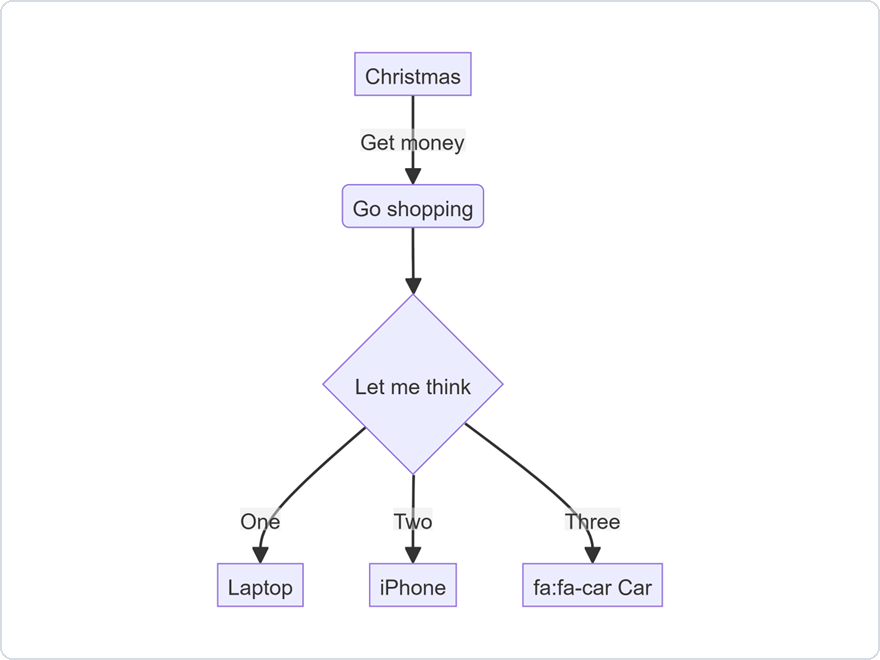</a>
        <br>
        <sub>流程图</sub>
      </td>
      <td align="center" valign="middle" width="50%" height="255">
        <a href="docs/images/diagram-sequence.png">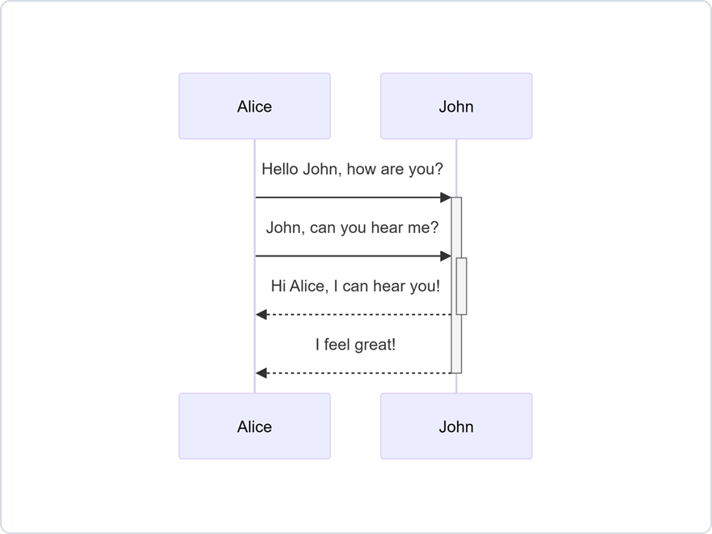</a>
        <br>
        <sub>时序图</sub>
      </td>
    </tr>
    <tr>
      <td align="center" valign="middle" width="50%" height="255">
        <a href="docs/images/diagram-class.png">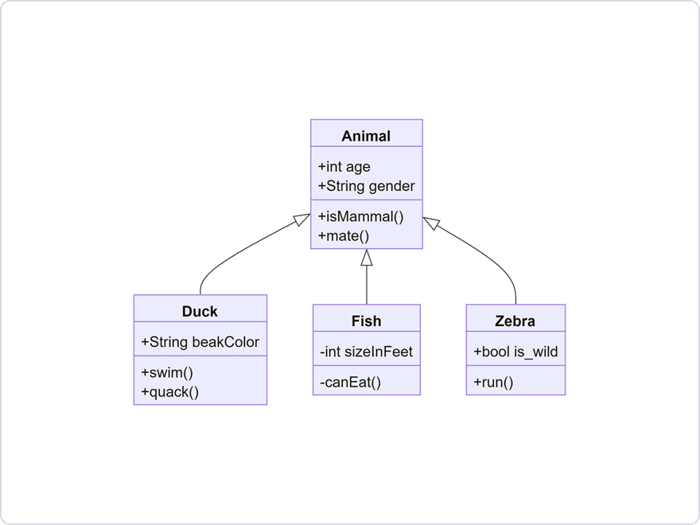</a>
        <br>
        <sub>类图</sub>
      </td>
      <td align="center" valign="middle" width="50%" height="255">
        <a href="docs/images/diagram-state.png">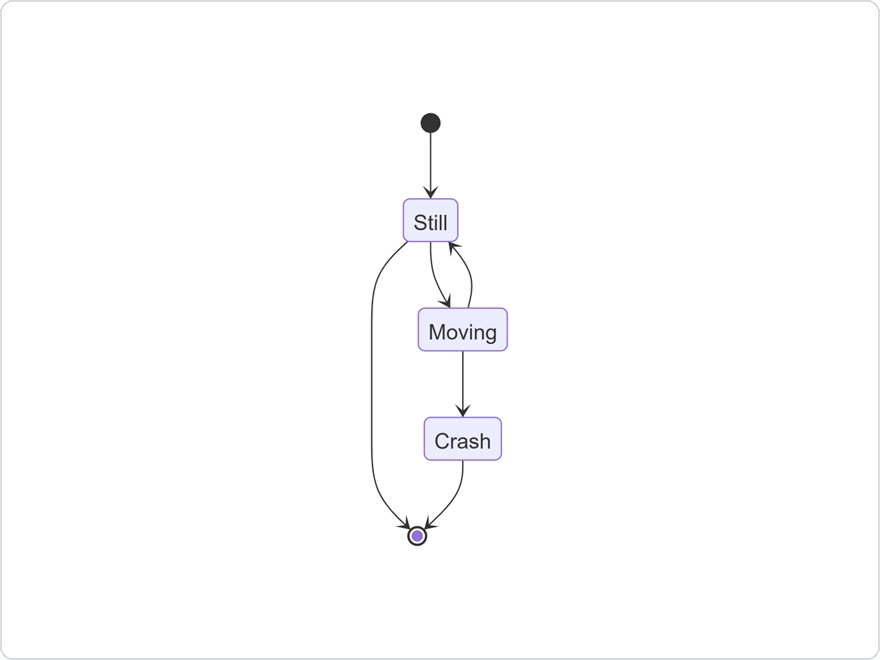</a>
        <br>
        <sub>状态图</sub>
      </td>
    </tr>
    <tr>
      <td align="center" valign="middle" width="50%" height="255">
        <a href="docs/images/diagram-er.png">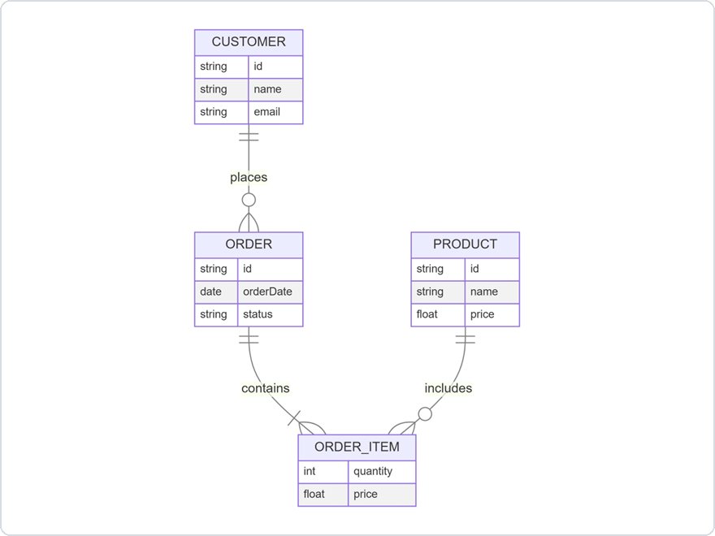</a>
        <br>
        <sub>实体关系图</sub>
      </td>
      <td align="center" valign="middle" width="50%" height="255">
        <a href="docs/images/diagram-gantt.png">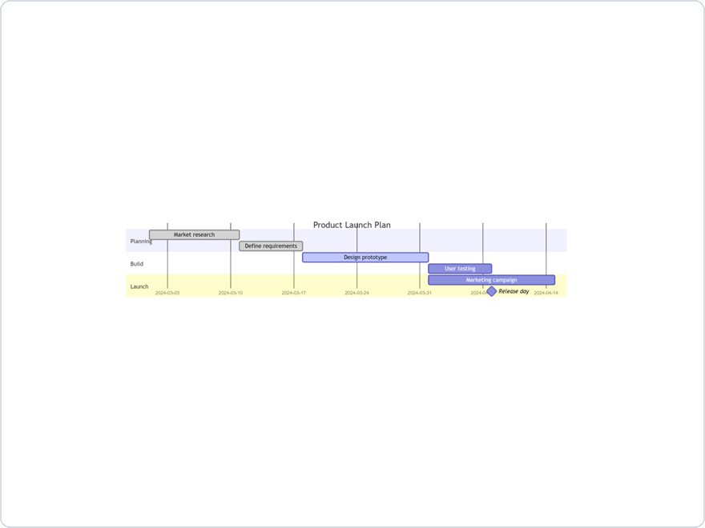</a>
        <br>
        <sub>甘特图</sub>
      </td>
    </tr>
    <tr>
      <td align="center" valign="middle" width="50%" height="255">
        <a href="docs/images/diagram-pie.png">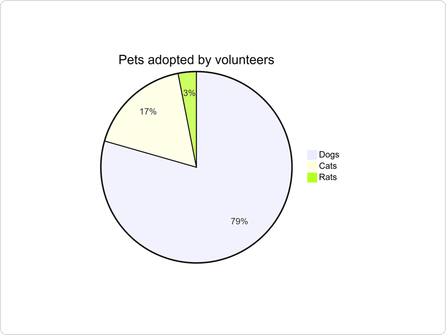</a>
        <br>
        <sub>饼图</sub>
      </td>
      <td align="center" valign="middle" width="50%" height="255">
        <a href="docs/images/diagram-mindmap.png">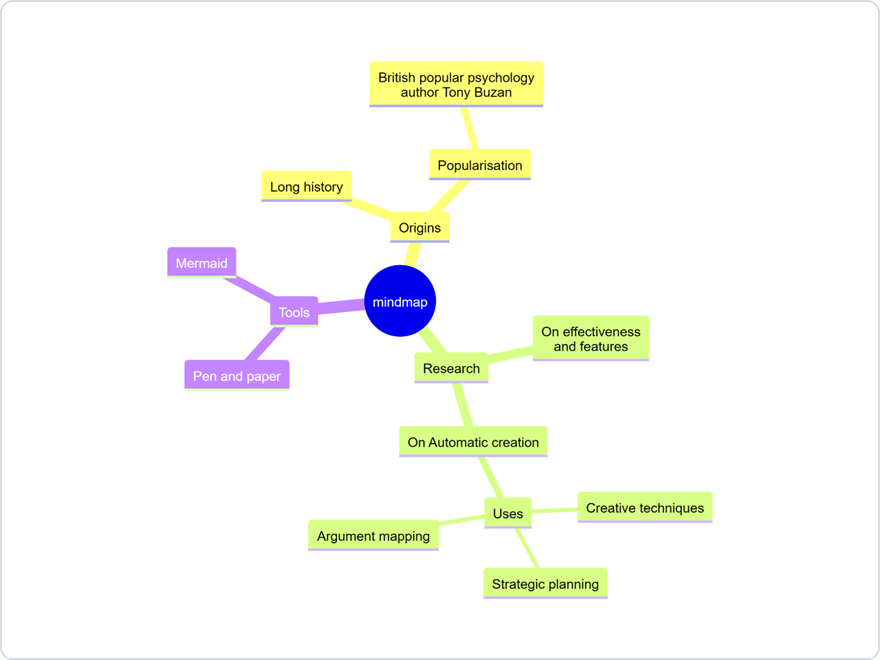</a>
        <br>
        <sub>思维导图</sub>
      </td>
    </tr>
  </table>

  语法以本项目依赖的 Mermaid 12.3.x 为准；官方 ZenUML 扩展已内置并自动注册。更多示例和版本限制见 [Mermaid 官方文档](https://mermaid.js.org/)。

- **内置示例**：**Example** 提供与 [Mermaid 在线编辑器](https://mermaid-live.nodejs.cn/edit) 同源的 35 种图表示例：采用 `@mermaid-js/examples` 中各图型的默认示例，并补充 ZenUML 的 **Order Service**。常用图型排在前面，其余按名称排序，菜单支持滚动。示例随加载项打包，加载时无需联网；选择示例会替换编辑器中的当前代码。

- **增强编辑体验**：提供 Mermaid 语法高亮、关键词补全、代码折叠、编辑器内语法诊断和自动换行。流程图、时序图、思维导图、饼图、旅程图、需求图和甘特图由上游语法完整着色；其余图型使用轻量词法高亮，词表随识别出的图型切换。
- **实时预览**：编辑 Mermaid 代码时同步查看渲染结果。支持鼠标滚轮缩放、按钮缩放、重置视图和拖拽平移。
- **主题切换**：支持 default、forest、dark 和 neutral 主题。
- **高质量输出**：支持高清 PNG 和矢量 SVG，可在 **Insert | Replace** 按钮右侧的下拉菜单中选择格式。
- **统一重新编辑**：PNG 和 SVG 均支持再次编辑。选中图片后点击 **Edit Selected**，修改后可选择任一格式替换原图。

## 快速使用

请先下载 [`manifest.xml`](https://mermaid-word-addin.pages.dev/manifest.xml)。

### Word 网页版

1. 在 [Word 网页版](https://word.cloud.microsoft) 中打开一份可编辑的文档，进入 **开始 → 加载项 → 更多加载项**。不同版本的入口也可能显示为 **更多设置**。

   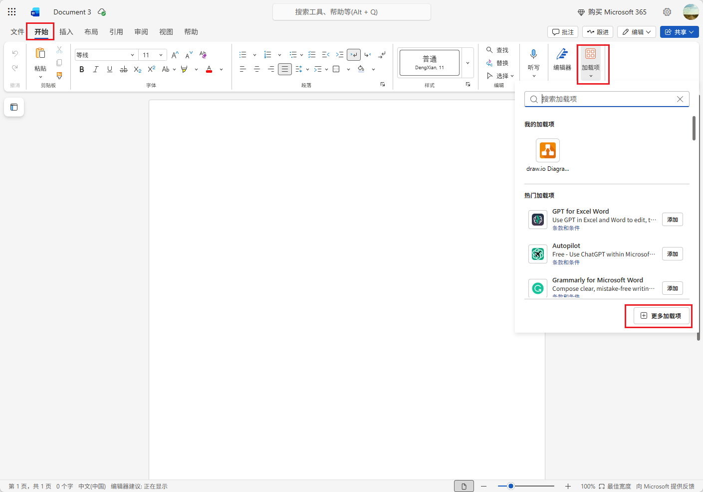

2. 切换到 **我的加载项**，展开 **管理我的加载项**，点击 **上传我的加载项**，选择下载的 `manifest.xml` 并完成上传。

   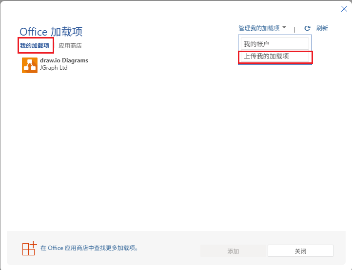

3. 在 **插入** 选项卡中点击 **Mermaid Editor**，右侧会打开代码编辑和预览窗格。

   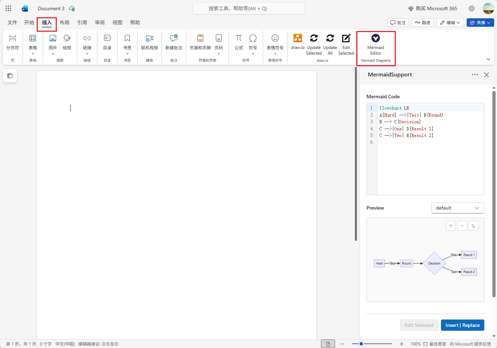

### Windows 桌面版 Word

1. **创建共享文件夹**。新建一个用于存放加载项清单的文件夹，将下载的 `manifest.xml` 放入其中。右键该文件夹，打开 **属性 → 共享→ 共享（S）...**，按向导为需要使用的 Windows 账号设置访问权限并完成共享。完成后复制网络路径。

   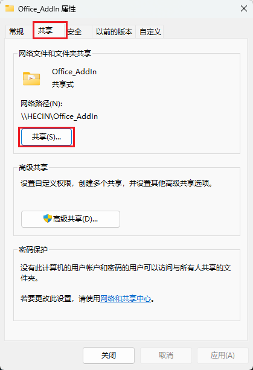

2. **添加受信任的加载项目录**。打开 Word，进入 **文件 → 选项 → 信任中心 → 信任中心设置 → 受信任的加载项目录（Trusted Add-in Catalogs）**。将上一步的网络路径粘贴到 **目录 URL（Catalog Url）**，点击 **添加目录（Add catalog）**，勾选新增条目的 **在菜单中显示（Show in Menu）**，然后依次点击 **确定** 关闭设置窗口。

   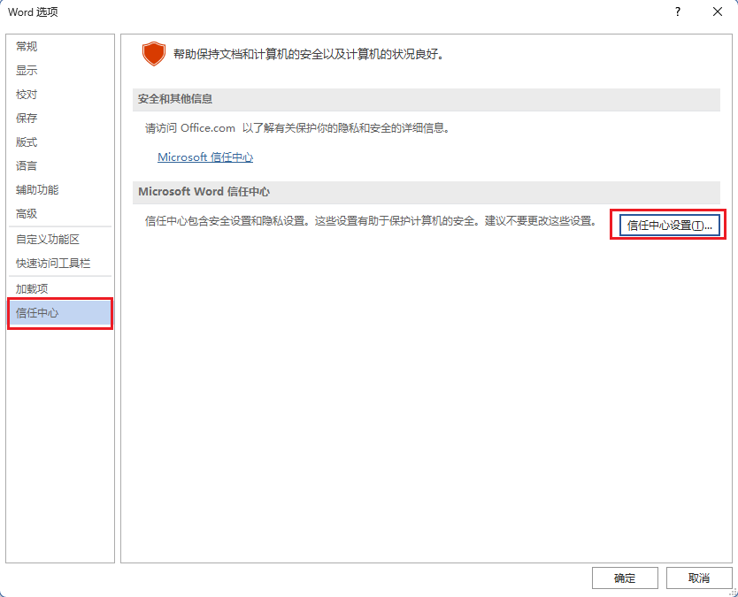

   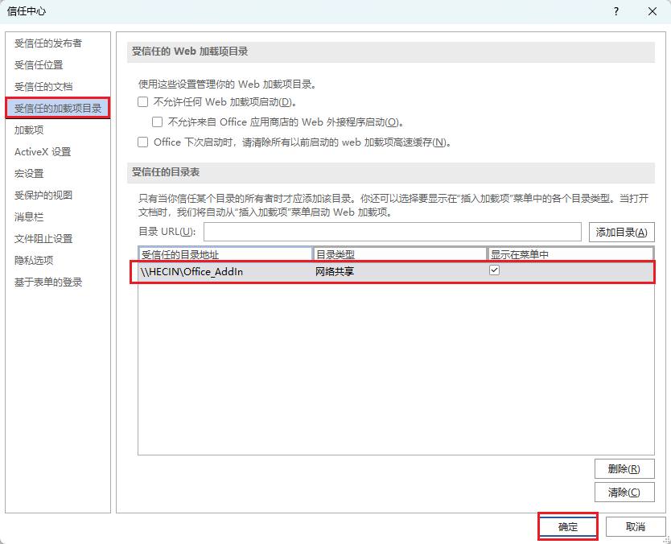

3. **重启 Word 并安装**。重新打开 Word，进入 **开发工具 → 加载项**，在 Office 加载项窗口中选择 **共享文件夹（Shared Folder）**，选中本加载项并点击 **添加**。

   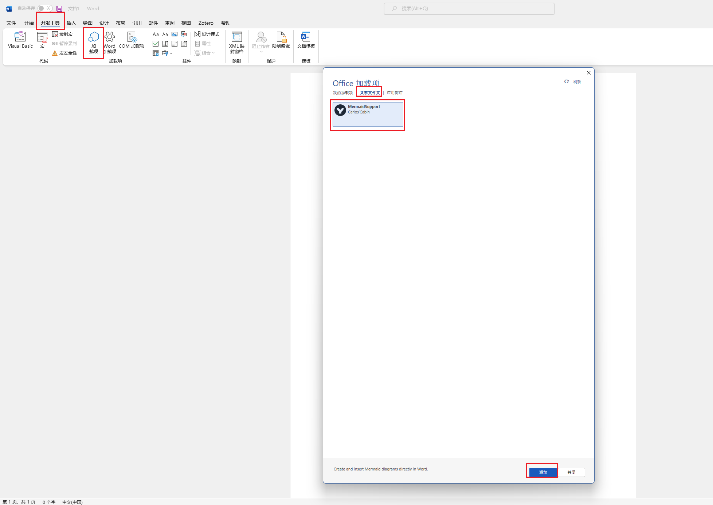

   随后在 **插入** 选项卡中打开 **Mermaid Editor**。

   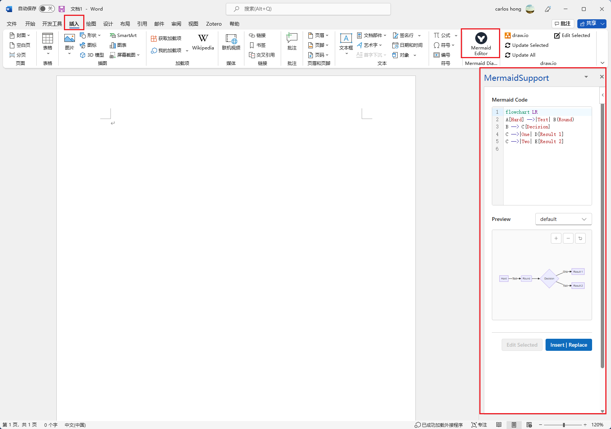

## 开发指南

### 环境

- Node.js 22.12+ 与 npm（Mermaid 12 和 ZenUML 扩展要求）
- Git
- Word

### 安装与启动

克隆仓库并进入项目目录：

```bash
git clone https://github.com/siyuhong/Mermaid-Word-AddIn.git
cd Mermaid-Word-AddIn
```

安装依赖：

```bash
npm install
```

### 构建与调试

构建开发版本：

```bash
npm run build:dev
```

首次配置时，安装本地 HTTPS 开发证书，并在系统提示中信任该证书：

```bash
npx office-addin-dev-certs install
```

启动开发服务器：

```bash
npm run dev-server
```

在另一个终端中将加载项侧载到 Word：

```bash
npm start
```

调试结束后移除开发加载项：

```bash
npm stop
```

## 部署指南

- [Cloudflare Pages 部署](docs/cloudflare-pages.zh-CN.md)

## 问题反馈

- **部署版**：见 [验证部署](docs/cloudflare-pages.zh-CN.md#5-验证部署)。
- **本地开发版**：任务窗格加载失败时，运行 `npx office-addin-dev-certs verify` 检查本地 HTTPS 证书；若提示需要安装，执行 `npx office-addin-dev-certs install` 并信任证书。

仍未解决时，请 [提交 Issue](https://github.com/siyuhong/Mermaid-Word-AddIn/issues)

## 参考资料

- [Mermaid 文档](https://mermaid.js.org/)
- [Office 加载项文档](https://learn.microsoft.com/office/dev/add-ins/overview/office-add-ins)
- [Word JavaScript API 参考](https://learn.microsoft.com/javascript/api/word)
- [在 Office 中侧载加载项进行测试](https://learn.microsoft.com/office/dev/add-ins/testing/sideload-office-add-ins-for-testing)
- [Office 加载项开发错误排查](https://learn.microsoft.com/office/dev/add-ins/testing/troubleshoot-development-errors)

## 许可证

MIT License，详见 [LICENSE](LICENSE)。
